  

# 🛡️ Awesome Compliance & Audit Logging

  
  
  
  
  

> 📋 A curated directory of enterprise SaaS platforms and battle-tested open-source tools for immutable audit trails, log management, SIEM event correlation, and regulatory compliance reporting (SOX, HIPAA, GDPR, PCI-DSS, SOC 2, ISO 27001).

---

## 📑 Table of Contents
- [📊 Sector Overview & Market Dynamics](#-sector-overview--market-dynamics)
- [☁️ SaaS & Cloud Platforms](#️-saas--cloud-platforms)
- [💻 Open-Source GitHub Projects](#-open-source-github-projects)
- [🏗️ Frameworks for Building Custom Audit Pipelines](#️-frameworks-for-building-custom-audit-pipelines)
- [📈 Star History](#-star-history)
- [🤝 Support & Community](#-support--community)
- [✍️ How to Contribute](#️-how-to-contribute)
- [⚠️ Disclaimer](#️-disclaimer)

---

## 📊 Sector Overview & Market Dynamics

The global Security Information and Event Management (SIEM) and log management market is valued at approximately **$8.0B to $12.1B** and is projected to expand beyond **$20B+** over the next decade, propelled by stringent regulatory compliance mandates (SOX, HIPAA, GDPR, PCI-DSS, and NIS2) and cloud-native infrastructure complexity. 📈

Structurally, the sector exhibits **bimodal market dynamics**:
- 🏛️ **High concentration at the enterprise apex**: Hyperscalers and consolidated legacy enterprise giants (such as Cisco/Splunk, Datadog, and Elastic) command the majority of large enterprise compliance and centralized telemetry budgets.
- 🧩 **Moderate to high fragmentation across specialized tiers**: The broader ecosystem remains fragmented across niche compliance automation platforms, specialized mid-market SIEMs, managed security service providers (MSSPs), and flexible open-source logging architectures catering to teams avoiding unpredictable per-GB ingest fees.

---

## ☁️ SaaS & Cloud Platforms

*Enterprise SaaS platforms providing centralized audit logging, cloud SIEM correlation, compliance reporting, and managed log retention. Sorted by company size (valuation / revenue, descending).* 🏢

| Product | Company Size (Valuation / Revenue) | Description | Starting Pricing | Free Tier & Free Trial Limits |
|:---|:---|:---|:---|:---|
| **[Splunk Cloud](https://www.splunk.com/)** | **~$28B Acquisition Valuation** (Parent Cisco: ~$220B+ Market Cap, ~$56.7B Rev) | Enterprise-grade SIEM and centralized log analytics powerhouse featuring specialized compliance frameworks and correlation rules. | **$675/month** (5 GB/day baseline tier on annual plan; ~$2,000/month for 20 GB/day) | **No free tier**; **15-day free trial** with up to 5 GB/day ingest limit (US East region only, max 10 concurrent searches, no data export, no REST API access) |
| **[Datadog Cloud SIEM](https://www.datadoghq.com/)** | **~$48B Market Cap** (~$2.6B+ Annual Revenue) | Cloud-native SIEM built directly on Datadog's unified log management pipeline. Correlates threats across logs and cloud infrastructure with 15-month security signal retention. | **$5.00 per million analyzed events/month** (annual commitment; $6.00/M month-to-month, $7.50/M on-demand; underlying log ingest billed separately) | **No free tier**; **14-day free trial** with full platform capabilities, multi-source log collection, and SIEM threat correlation rules |
| **[Zoho Audit Trail](https://www.zoho.com/)** | **~$12.5B Valuation** (~$1.5B Annual Revenue) | Built-in audit trail and data change governance within Zoho Creator and Zoho Commerce for enterprise application activity tracking. | **$8.00/user/month** (billed annually for Zoho Creator Standard tier) | **Free Forever plan available**: Zoho Creator Free Tier supports 1 app, 1 user, 250 MB storage, and **3 months of change audit trail history** (paid plans extend retention to 3 years) |
| **[Elastic Security](https://www.elastic.co/)** | **~$8.5B Market Cap** (~$1.3B Annual Revenue) | Full-stack SIEM and security analytics engine built on Elasticsearch, offering endpoint protection, out-of-the-box compliance dashboards, and behavioral rules. | **$0.09 per GB ingested** (Security Analytics Essentials serverless tier; $0.11/GB on Complete tier) | **Free Forever tier available**: **50 GB free ingest/month** on Serverless Security Essentials; **14-day free trial** of hosted Elasticsearch / Elastic Cloud with standard cluster resources |
| **[SolarWinds Papertrail](https://www.papertrail.com/)** | **~$3.2B Market Cap** (~$800M Annual Revenue) | Hosted log management and real-time log aggregation built for quick search, live tailing, and audit log archival. | **$7.00/month** (includes 1 GB/month search allowance and 30-day archival) | **Free Forever plan available**: **50 MB/month log storage**, 1-day searchable retention, and 1-year downloadable archives |
| **[AuditBoard](https://www.auditboard.com/)** | **~$3.0B Valuation** (Acquired by Hg, ~$200M+ ARR) | Connected GRC and internal audit platform purpose-built for SOX compliance, risk management, and regulatory control tracking. | **~$20,000 to $25,000/year** (verified procurement starting baseline for single module/small team deployments; typical median spend ~$43,000–$46,000/yr) | **No free tier**; interactive vendor product demonstration and tailored proof-of-concept trial arranged via sales |
| **[Sumo Logic](https://www.sumologic.com/)** | **~$1.7B Valuation** (Acquired by Francisco Partners) | Cloud-native SIEM and observability platform offering Flex scan-based pricing alongside traditional credit models. | **$0.25 per credit** (Enterprise Suite Credit model) / **$1.50 per credit** (Enterprise Suite Flex model; Cloud SIEM ingest billed at 40 credits/GB) | **Free Forever plan (Flex model)**: **1.25 credits/day**, 7-day log retention, up to 3 users; **30-day free trial** includes ~1 GB/day ingest, ~500 GB daily search capacity, 30-day retention, and up to 20 users |
| **[Panther](https://panther.com/)** | **~$1.4B Valuation** ($120M Series B Unicorn) | Cloud-scale, detection-as-code security analytics and audit log SIEM querying data lakes via Python and SQL without per-analyst licensing fees. | **$3,000/month** (~$3,000–$6,000/TB/month baseline tier; annual enterprise minimums typically starting at $50,000/year) | **No free tier**; custom self-serve demo sandbox and **30-day guided enterprise evaluation trial** arranged through sales engineering |
| **[LogRhythm (Exabeam)](https://www.logrhythm.com/)** | **~$1.2B Valuation** (~$300M Combined Revenue with Exabeam) | Enterprise SIEM offering centralized compliance frameworks, log collection, and UEBA behavioral monitoring. | **~$2,000/year** (starting software-only entry license tier; Axon Cloud SIEM metered by GB/day starting thresholds) | **No free tier**; **30-day guided proof-of-concept trial** and guided interactive virtual lab available upon qualification |
| **[Graylog Enterprise Cloud](https://graylog.org/)** | **~$60M–$100M Valuation** (~$18M+ ARR) | Centralized enterprise log management and SIEM platform offering compliance reporting, automated alerting, and audit dashboards. | **$2,500/year** (starting entry tier for Graylog Operations / Security Cloud up to 5 GB/day ingest) | **Free Forever plan available**: **Graylog Open edition is 100% free** (includes up to 16 GB storage, single-node full-fidelity log capture, threat detection, and API discovery); **14-day free trial** for Graylog Enterprise Cloud |

---

## 💻 Open-Source GitHub Projects

*Active self-hosted log management engines, audit frameworks, telemetry collectors, and open-source SIEM solutions. Sorted by GitHub_Stars (descending).* 🌟

| Project | GitHub_Stars | Category / Focus | Description |
|:---|:---:|:---|:---|
| **[elastic/elasticsearch](https://github.com/elastic/elasticsearch)** |  | Distributed Log Search & Indexing | Distributed, JSON-based search and analytics engine powering the ELK stack; widely used as the primary indexing backend for enterprise compliance audit logs. |
| **[osquery/osquery](https://github.com/osquery/osquery)** |  | Endpoint Auditing & OS Telemetry | Exposes an entire operating system as a high-performance relational database, enabling SQL-based querying of audit events, process creation, file integrity, and user logins. |
| **[wazuh/wazuh](https://github.com/wazuh/wazuh)** |  | Open-Source SIEM & XDR | Comprehensive open-source security platform combining log analysis, file integrity monitoring (FIM), vulnerability detection, and regulatory compliance mapping (PCI-DSS, HIPAA, GDPR, CIS). |
| **[opensearch-project/OpenSearch](https://github.com/opensearch-project/OpenSearch)** |  | Distributed Search & Log Analytics | Community-driven, 100% open-source search and analytics suite (Apache 2.0) with dedicated Security Analytics plugins for correlation, alert generation, and audit indexing. |
| **[fluent/fluentd](https://github.com/fluent/fluentd)** |  | Log Collection & Routing Layer | CNCF-graduated unified logging layer that decouples data sources from backend storage, ensuring reliable buffering and filtering of audit streams. |
| **[fluent/fluent-bit](https://github.com/fluent/fluent-bit)** |  | Lightweight Log & Metric Processor | High-performance, low-memory telemetry and log shipper ideal for Kubernetes nodes, embedded devices, and microservice audit log transport. |
| **[Graylog2/graylog2-server](https://github.com/Graylog2/graylog2-server)** |  | Centralized Log Management & SIEM | Mature self-hosted log management and SIEM platform offering full-fidelity log ingestion, live message streaming, alerting, and forensic query capabilities. |
| **[open-telemetry/opentelemetry-collector](https://github.com/open-telemetry/opentelemetry-collector)** |  | Vendor-Neutral Telemetry Gateway | Proxy and collector for receiving, processing, and exporting audit telemetry, traces, and structured application security logs without vendor lock-in. |
| **[javers/javers](https://github.com/javers/javers)** |  | Object Auditing & Entity Diffs | Audit log and object versioning framework for Java and Spring Boot applications, recording state changes and diffs in relational or MongoDB stores. |
| **[turbot/tailpipe](https://github.com/turbot/tailpipe)** |  | Terminal SIEM & DuckDB Log Engine | Open-source CLI SIEM querying cloud and host audit logs (AWS CloudTrail, GitHub Audit, GCP, Azure Activity, nginx) via DuckDB SQL without requiring an external database. |
| **[DamienHarper/auditor-bundle](https://github.com/DamienHarper/auditor-bundle)** |  | Doctrine ORM Entity Auditing | Complete audit log bundle for PHP / Symfony applications using Doctrine ORM, automatically recording entity creation, modifications, and deletions. |
| **[pgMemento](https://github.com/pgMemento/pgMemento)** |  | PostgreSQL Schema & Data Auditing | Non-intrusive database change-data-capture audit trail and schema versioning for PostgreSQL utilizing transactional JSONB logs. |
| **[boxyhq/hermes](https://github.com/boxyhq/hermes)** |  | SaaS Audit Logs Service | Compliance-ready audit logging service designed specifically for modern SaaS applications requiring SOC 2 and GDPR-ready audit event export. |

---

## 🏗️ Frameworks for Building Custom Audit Pipelines

For engineering teams seeking to eliminate per-gigabyte SaaS ingestion costs, a resilient, tamper-evident compliance audit architecture can be assembled entirely with open-source tools: 🛠️

1. 🔍 **Host & OS Telemetry**: Deploy **osquery** across endpoints and server nodes for scheduled file-integrity checks, user session auditing, and configuration states.
2. 🚚 **Data Shippers & Routing**: Use **Fluent Bit** or **OpenTelemetry Collector** as lightweight node-level daemons to parse structured JSON logs and securely ship them over TLS.
3. 🗄️ **Database & Application-Level Auditing**: Implement **pgMemento** (PostgreSQL) or **javers** / **boxyhq/hermes** (application layers) to maintain tamper-evident, append-only history of critical entity modifications.
4. 🛡️ **Aggregation, SIEM & Retention**: Ingest into **Wazuh** or **Graylog Open** with an **OpenSearch** storage backend for live alert correlation, role-based access control (RBAC), and multi-year cold storage compliance retention.
5. ⚡ **Ad-hoc Investigations**: Query CloudTrail, GCP, and GitHub audit exports directly with **Tailpipe** using local DuckDB SQL.

---

## 📈 Star History

---

## 🤝 Support & Community

Thank you so much for exploring and using **Awesome Compliance & Audit Logging**! ❤️ 

If this curated repository helps you navigate compliance requirements, architect secure audit pipelines, or evaluate SIEM solutions:
- ⭐ **Star this repository** to help others discover it!
- 🍴 **Fork it** to contribute new tools or maintain your customized playbook.
- 📢 **Share it** with your fellow security engineers, compliance officers, and developers.
- ☕ **Buy a coffee / Sponsor**: If you'd like to back this work and ongoing maintenance, consider sponsoring via the [GitHub Sponsors Dashboard](https://github.com/sponsors/ishandutta2007). Your support is greatly appreciated!

---

## ✍️ How to Contribute

We welcome additions, corrections, and updates from the compliance and cybersecurity community! 🚀

1. Fork this repository.
2. Create a new branch: `git checkout -b update-logging-tools`.
3. Add or update tool listings in `README.md` adhering to the table format (include exact pricing/trial terms, company valuation/revenue, or active GitHub stargazers).
4. Commit your changes: `git commit -m "Add <Tool-Name> with pricing and compliance features"`.
5. Push to your branch and open a Pull Request.

---

## ⚠️ Disclaimer

- This list is community-curated for informational and architectural guidance; it does not constitute formal legal or regulatory endorsement.
- Compliance audit records contain sensitive operational details and potential PII. Ensure all deployments enforce TLS encryption in transit, AES-256 encryption at rest, immutable/WORM (Write Once, Read Many) retention policies, and cryptographic integrity checks to satisfy defensibility requirements under SOX, HIPAA, and GDPR.

---

  <b>Built with ❤️ for compliance officers, security engineers, SOC analysts, and cloud architects building audit-ready infrastructure.</b>

